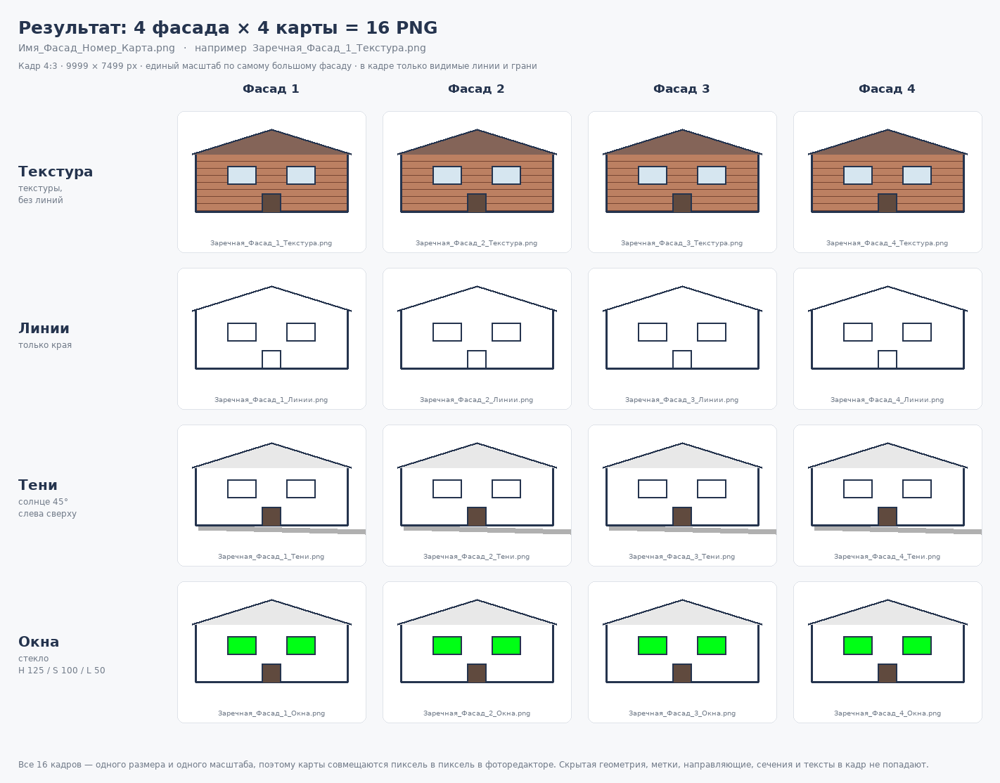
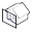

# Экспорт фасадов — плагин для SketchUp

Автоматический экспорт 2D-геометрии фасадов в PNG: **4 фасада × 4 визуальные карты = 16 изображений** по нажатию одной кнопки.

**Автор:** Артем Титов — `motivate_rt`
**Версия:** 1.5.0
**SketchUp:** 2021, 2025 и новее (Windows и macOS)

> **Быстрая установка:** взять [`dist/FacadeExport_v1.5.0.rbz`](dist/FacadeExport_v1.5.0.rbz)
> и в SketchUp выполнить **Окно → Менеджер расширений → Установить расширение…**



---

## Содержание

1. [Что делает плагин](#что-делает-плагин)
2. [Установка](#установка)
3. [Как пользоваться](#как-пользоваться)
4. [Кадр: пропорции, масштаб и отступ](#кадр-пропорции-масштаб-и-отступ)
5. [Что именно настраивает плагин](#что-именно-настраивает-плагин)
6. [Настройки плагина](#настройки-плагина)
7. [Как это работает внутри](#как-это-работает-внутри)
8. [Важные замечания и ограничения](#важные-замечания-и-ограничения)
9. [Структура проекта](#структура-проекта)
10. [Тесты и сборка](#тесты-и-сборка)
11. [Изученные материалы](#изученные-материалы)

---

## Что делает плагин

Пользователь выравнивает вид перпендикулярно фасаду и нажимает кнопку. Плагин сам:

* настраивает стиль отображения (фон, рёбра, грани, направляющие, тени, параллельная проекция);
* кадрирует **то, что экспортируется**: всю модель или — если пользователь вошёл
  в группу/компонент — только содержимое этой группы, без окружения;
* считает кадр по правилам: **4:3**, большая сторона **9999 px**, самый большой
  фасад задаёт масштаб, фасад стоит почти вплотную к **нижнему** краю;
* строит габариты **только по видимым линиям и граням**: скрытые объекты,
  геометрия со скрытых меток, направляющие, сечения, размеры и тексты кадр
  не растягивают;
* разворачивает кадр для высотных объектов: у башни 9999 px уходит по вертикали;
* поворачивает камеру на 90° на каждый следующий фасад, сохраняя **один и тот же масштаб**;
* для каждого фасада экспортирует 4 PNG-карты (или больше, если добавить свои карты);
* возвращает стиль, тени и камеру пользователя в исходное состояние, а в
  журнале «Отменить» не оставляет ни одного шага экспорта.

В результате в выбранной папке появляется 16 файлов:

```
Префикс_Фасад_1_Текстура.png     Префикс_Фасад_2_Текстура.png
Префикс_Фасад_1_Линии.png        Префикс_Фасад_2_Линии.png
Префикс_Фасад_1_Тени.png         Префикс_Фасад_2_Тени.png
Префикс_Фасад_1_Окна.png         Префикс_Фасад_2_Окна.png
... и так же для фасадов 3 и 4
```

Префикс — это имя, которое пользователь вписал в окне сохранения.
Пример: вписал `Заречная` → `Заречная_Фасад_1_Текстура.png`.

| Карта | Что на ней | Как получено |
|-------|------------|--------------|
| **Текстура** | только текстуры материалов, без линий | Затенение, текстуры включены, края скрыты, прозрачность материала выключена; стеклянные ограждения исчезают |
| **Линии** | только линии | Скрытые линии, края показаны; стеклянные ограждения исчезают |
| **Тени** | только тени под 45° слева сверху | Белые грани без краёв + тени, солнце 45°/45°, «светлее» 100, «темнее» 0; стеклянные ограждения исчезают |
| **Окна** | все стеклянные поверхности контрастным цветом | Тени выключены, «затенение», стекло перекрашено по типам (см. ниже) |

### Типы стекла

Тип определяется по непрозрачности материала (вкладка «Материалы → Правка материала»):

| Непрозрачность | Тип | Цвет на карте окон | Поведение на остальных картах |
|----------------|-----|--------------------|-------------------------------|
| 0–10 % | стеклянные ограждения | H 300 / S 100 / L 50 | исчезают (непрозрачность 0 %) |
| 11–89 % | основное стекло | H 125 / S 100 / L 50 | **непрозрачное**, но со своим цветом и текстурой |
| 90–99 % | тонированное стекло | H 180 / S 100 / L 50 | **непрозрачное**, но со своим цветом и текстурой |
| ≥ 99,5 % | обычный материал | не трогается | — |

На картах «Текстура», «Линии» и «Тени» стекло не просвечивает: плагин временно
делает основное и тонированное стекло непрозрачным (цвет и текстура
сохраняются), поэтому за фасадом не видно лишних объектов и на стекло
нормально ложатся тени. Прозрачными остаются только ограждения — их на этих
картах просто нет.

В настройках карты «Окна» есть галочка **«Разделять карты по типам стекла»**
(по умолчанию выключена). Если её включить, вместо одной карты «Окна» появится три:
**«окно-стекло»**, **«окно-тонировка»**, **«окно-ограждения»**. На каждой такой карте
показан только свой тип стекла, остальные типы прозрачные. То же доступно на своей
карте (блок «Окна и стекло»): её карты называются
`Префикс_Фасад_Н_Своя карта 1 — окно-стекло.png`.

---

## Установка

### Вариант 1. Файл `.rbz` (проще всего)

1. Взять готовый архив `dist/FacadeExport_v1.5.0.rbz` из этого репозитория
   (или собрать его самому: `python3 tools/build_rbz.py`).
2. В SketchUp: **Окно → Менеджер расширений → Установить расширение…** и выбрать `.rbz`.
3. Согласиться с предупреждением и перезапустить SketchUp.
4. Появится панель инструментов **«Экспорт фасадов»** и меню
   **Расширения → Экспорт фасадов**.

### Вариант 2. Вручную (для разработки)

Скопировать в папку `Plugins` SketchUp:

```
Plugins/
├── facade_export.rb          ← загрузчик расширения (лежит в корне репозитория)
└── facade_export/            ← папка плагина целиком
    ├── main.rb
    ├── config.rb
    ├── util.rb
    ├── scene_state.rb
    ├── framing.rb
    ├── sun.rb
    ├── glass.rb
    ├── exporter.rb
    ├── dialogs.rb
    ├── html/settings.html
    └── icons/*.png
```

Путь к `Plugins`:
* Windows: `%AppData%\SketchUp\SketchUp 20XX\SketchUp\Plugins`
* macOS: `~/Library/Application Support/SketchUp 20XX/SketchUp/Plugins`

После правки Ruby-файлов достаточно перезапустить SketchUp (или выполнить
`FacadeExport.register_ui` заново в консоли Ruby).

---

## Как пользоваться

1. Открыть модель. Если нужен только один корпус — **войти внутрь группы/компонента**:
   плагин экспортирует именно её содержимое, без окружения.
2. Выровнять вид **перпендикулярно основной плоскости фасада**
   (Камера → Стандартные виды, либо правый клик по грани → «Выровнять вид»).
3. Нажать:
   * **Экспорт всех фасадов** — 4 фасада × 4 карты = 16 PNG;
   * **Экспорт фасада** — только текущий фасад = 4 PNG.
4. В появившемся окне выбрать **папку и имя файла**. Имя, которое вы впишете, —
   это **префикс всех будущих PNG** (сохраняется и в следующий раз).
5. Плагин экспортирует изображения «за кадром» и показывает отчёт:
   сколько файлов, за какое время, среднее время на изображение, объём.
6. Вид, стиль, тени, выделение и камера возвращаются к тому состоянию, в котором
   пользователь нажимал кнопку — можно продолжать работу.

Кнопки:

| Кнопка | Действие |
|--------|----------|
|  **Экспорт всех фасадов** | 4 фасада × 4 карты = 16 PNG |
|  **Экспорт фасада** | 4 карты текущего вида = 4 PNG |
|  **Настройки…** | окно настроек карт и экспорта |

Иконки — эскизы автора **без правок**: файлы `*_32.png` в плагине побайтово
совпадают с исходниками из `tools/icons_src/` (раскрытая коробка с розовыми
стенами — «все фасады», коробка с выделенной передней стеной — «один фасад»,
шестерёнка — «Настройки»). Для панели инструментов дополнительно готовится
24×24 тем же рисунком (`tools/make_icons.py` только уменьшает 32 → 24).

---

## Кадр: пропорции, масштаб и отступ

Правила кадра (одинаковые для всех карт и всех фасадов):

1. **Пропорции 4:3** (меняется в «Расширенные настройки → Соотношение сторон»:
   4:3, 3:2, 16:9, 2:1, 3:1, 1:1 — только «широкие» варианты, вертикальные
   не нужны, потому что плагин сам разворачивает кадр под высокий объект).
2. **Большая сторона 9999 px**, вторая считается по пропорциям: 9999 × 7499.
3. **Высотные объекты** (башни, небоскрёбы): 9999 px уходит по вертикали —
   кадр 7499 × 9999.
4. **Самый большой фасад задаёт масштаб.** Плагин проецирует габариты на все четыре
   направления и выбирает то, у которого самая длинная сторона; остальные фасады
   получают тот же масштаб, поэтому карты совпадают пиксель в пиксель. Неважно,
   с какого фасада пользователь начал.
5. **Фасад прижат к низу кадра**: снизу остаётся только отступ
   (`export.margin`, по умолчанию 2 %), сверху — сколько получится.
   По горизонтали фасад центрируется.
6. **Размер PNG не зависит от размера окна просмотра SketchUp**, поэтому на разных
   компьютерах получаются одинаковые файлы.
7. Кадрируется ровно то, что экспортируется: вся модель или открытая группа.
8. **Габариты строятся только по видимым линиям и граням** — см. следующий раздел.

### Скрытая геометрия в кадр не входит

Габариты объекта считаются по **видимым рёбрам и граням**, а не по габаритному
ящику сущностей:

* скрытые объекты (в том числе спрятанные внутри групп и компонентов);
* геометрия со скрытых меток (тегов) и меток в скрытых папках;
* направляющие и точки привязки;
* сечения (их рамки);
* размеры, тексты, оси;
* скрытые линии и грани.

Такие объекты не только не растягивают кадр — они вообще не рисуются в PNG:
плагин всегда включает `HideConstructionGeometry`, выключает `DisplayText`,
`DisplayDims`, `DisplaySketchAxes`, `DisplayInstanceAxes`, `DisplaySectionPlanes`
и `DrawHidden`. Раньше в расчёт попадал габаритный ящик сущности, и забытая
на скрытой метке геометрия раздувала кадр: горизонтальный фасад оказывался
в вертикальном соотношении с большим пустым отступом.

Если видимой геометрии нет совсем, плагин честно сообщает об этом вместо того,
чтобы снимать пустой кадр.

### Режим «Экспортировать только видимый участок»

Выключен по умолчанию. Когда включён, плагин **ничего не подгоняет**:

* в PNG попадает ровно то, что видно в окне SketchUp — тот же ракурс, тот же
  зум и та же композиция (нижняя привязка и отступ не применяются);
* **соотношение сторон и размеры берутся из настроек** (4:3 → 9999×7499,
  длинная сторона из поля «ширина»), а не из окна просмотра — файлы одинаковы
  на любом компьютере и при любом размере окна;
* остальные фасады снимаются той же камерой, повёрнутой на 90° вокруг цели;
* стиль, тени и перекраска стекла работают как обычно.

### Перспектива → параллельная проекция

Плагин рассчитан на параллельную проекцию (она же включена в настройках
по умолчанию). Если пользователь смотрит в перспективе, плагин **до начала
экспорта** переводит сам вид в параллельную проекцию: сохраняются точка
взгляда, цель, направление и наклон камеры, а высота кадра подбирается такой,
чтобы вместить то же, что вмещала перспектива. Только после этого считаются
кадры и снимаются фасады — иначе зум и высота кадра считались бы по
перспективе и картинки расходились бы между фасадами. После экспорта исходная
камера пользователя возвращается вместе со всем остальным. Если в настройках
сознательно выбрана перспективная проекция, вид не трогается.

Отдельной настройки «масштаб по каждому фасаду» нет — она не нужна и только путает.

---

## Что именно настраивает плагин

### Общие настройки стиля для всего экспорта (шаг 1 задания)

| Требование задания | Реализация |
|--------------------|------------|
| Вид: скрыть направляющие | `HideConstructionGeometry = true` |
| Правка → Фон: убрать небо и землю | `DrawSky = false`, `DrawGround = false`, `DrawHorizon = false` |
| Фон RGB 255,255,255 | `BackgroundColor`, `SkyColor`, `GroundColor` = белый |
| Правка → Край: убрать профили, показ глубин, расширение, конечные точки, дрожание, пунктир | `DrawProfilesOnly`, `DrawDepthQue`, `ExtendLines`, `DrawLineEnds`, `JitterEdges`, `DisplayLineStyles` = false (+ силуэты) |
| Правка → Грань: убрать задние рёбра и рентген | `DrawBackEdges = false`, `ModelTransparency = false` |
| Тени: не использовать солнце для затенения | `UseSunForAllShading = false` |
| Камера: параллельная проекция | `camera.perspective = false` (включена по умолчанию) |
| Кадрировать по содержимому | `Framing.content_bounds` + `Framing.plan` |

### Карты (шаг 3 задания)

| Карта | Режим отображения | Края | Тени | Особое |
|-------|-------------------|------|------|--------|
| Текстура | Затенение (`RenderMode = 2`) + текстуры | скрыты (`EdgeDisplayMode = 0`) | выключены | прозрачность материала выключена; ограждения исчезают |
| Линии | Скрытые линии (`RenderMode = 1`) | показаны (`EdgeDisplayMode = 1`) | выключены | ограждения исчезают |
| Тени | `RenderMode = 1` (грани белые) | скрыты | **включены**: солнце 45° слева сверху, «светлее» 100, «темнее» 0 | ограждения исчезают |
| Окна | `RenderMode = 2` (без текстур) | скрыты | выключены | стекло по типам: 125/180/300 H, после экспорта всё возвращается |

### Сечения

Если в модели включены плоскости сечения, они **продолжают резать геометрию**
и на экспорте: параметр `DisplaySectionCuts` всегда включается. Скрываются только
рамки плоскостей (`DisplaySectionPlanes = false`). Это отличается от старых
версий плагина, которые отключали сечения полностью.

### Поворот камеры (шаги 4, 6, 8, 10 задания)

Каждый следующий фасад — поворот горизонтального направления взгляда на 90°.
Масштаб общий: он считается по самому большому фасаду и не меняется между кадрами.
Вид, стиль и тени после четвёртого фасада возвращаются в исходное состояние.

---

## Настройки плагина

**Расширения → Экспорт фасадов → Настройки…** (или кнопка с шестерёнкой).

Окно сделано компактным, без лишних уровней вложенности.

**Вкладка «Экспорт», на виду:** длина большей стороны (9999 px, максимум 9999),
высота (0 — по пропорциям), множитель масштаба линии (0,3x), отступ вокруг фасада
(0,02), «возвращать вид и стиль», «показывать отчёт», **«при экспорте одного фасада
подгонять по самому большому»** (по умолчанию выключено) и **«экспортировать только
видимый участок»** (по умолчанию выключен).
Всё остальное — в единственном раскрывающемся блоке **«Расширенные настройки»**
(соотношение сторон 4:3, параллельная проекция, «использовать солнце для затенения»,
прозрачный фон, сглаживание, «скрывать небо», «скрывать землю» — обе включены
по умолчанию, водяные знаки, цвет фона).

Настроек направляющих, осей, размеров, текстов и плоскостей сечений больше нет:
эта служебная графика не попадает в кадр всегда.

Два столбца настроек разделены широким зазором и тонкой вертикальной линией,
поэтому рамка поля (в том числе выпадающего списка) из левого столбца не
соприкасается с правым.

**Вкладка карты** — никаких расширенных настроек, всё сразу на виду:

* название (попадает в имя файла);
* режим отображения;
* «экспортировать эту карту»;
* «края (линии)»;
* «тени» — и **настройки теней появляются ниже только тогда, когда этот флажок
  включён**: смещение солнца влево, высота солнца, «светлее», «темнее»;
* «прозрачность материала».

Отдельной галочки «Текстуры» нет: текстуры есть ровно в режиме **«Затенение»**,
в остальных режимах SketchUp их не рисует — плагин выводит это из режима сам.

**Одиночный фасад с общим масштабом.** Если включить «При экспорте одного фасада
подгонять по самому большому», плагин при съёмке одного вида всё равно считает
проекции всех четырёх сторон, берёт масштаб по самому большому фасаду и кадрирует
текущий вид этим масштабом. Одиночный кадр получается точно таким же, как
соответствующий кадр полного экспорта. По умолчанию выключено: одиночный фасад
занимает кадр целиком.

**Карта «Окна»** дополнительно содержит блок **«Настройки отображения окон»**:
«разделять карты по типам стекла» и цвета H/S/L для трёх типов стекла.

**Своя карта.** Кнопка **«+»** справа от вкладок добавляет карту с полным набором
настроек: название, режим, края, тени (с блоком настроек теней), прозрачность
материала и блок **«Окна и стекло»** — «перекрашивать стекло на этой карте»,
разделение по типам стекла и цвета H/S/L. Такая карта экспортируется вместе
с остальными, а удаляется кнопкой «Удалить карту» на своей вкладке.

Нижняя панель с кнопками закреплена: она не меняет высоту и не «ужимается» при
раскрытии расширенных настроек — прокручивается только содержимое вкладки.

Настройки хранятся в `Sketchup.read_default/write_default` (раздел `FacadeExport`),
т.е. переживают перезапуск SketchUp.

Посмотреть, как выглядит окно, можно без SketchUp:
[`docs/settings_preview.html`](docs/settings_preview.html).

Дополнительные материалы в `docs/`:

* [`docs/checklist.md`](docs/checklist.md) — сверка ТЗ и реализации пункт за пунктом;
* [`docs/maps_scheme.png`](docs/maps_scheme.png) — схема 16 изображений;
* [`docs/icons_preview.png`](docs/icons_preview.png) — иконки кнопок в 24 и 32 px.

---

## Как это работает внутри

### 1. Экспорт без перерисовки вьюпорта

Все изображения пишутся через `Sketchup::View#write_image` в режиме рендера «за кадром»:
SketchUp рисует кадр нужного размера в память и сохраняет PNG. Окно просмотра
не меняет размер, не мигает и не перерисовывается 16 раз — интерфейс не «дёргается»,
процессор не тратится на лишние кадры. Размер изображения берётся из настроек,
а не из окна.

### 2. Минимум изменений стиля

Для каждой карты сравниваются текущие значения с нужными, и записываются
**только отличающиеся** параметры (`OptionBag#apply`). Ключи, которых нет в данной
версии SketchUp, пропускаются (`RenderingOptions#keys`), поэтому плагин одинаково
работает в 2021 и в 2025+, где запись неизвестного ключа уже выбрасывает `ArgumentError`.

### 3. Тени 45° слева сверху

Использован принцип плагина **Elevation 45 Shadows** (TIG): «география» модели
(широта, долгота, часовой пояс, время) подменяется так, чтобы солнце встало
в нужную точку, а `NorthAngle` разворачивает его относительно вида.

Отличие в реализации: вместо готовой формулы угол **калибруется по факту**.
Плагин ставит пробное значение `NorthAngle`, читает фактический `SunDirection`,
считает масштаб отклика и итеративно подбирает `NorthAngle` и `Latitude` так,
чтобы солнце оказалось точно под 45° к фасаду и на высоте 45° (тени падают
вправо-вниз под 45°). Если `SunDirection` недоступен, используется оригинальная
формула TIG. После экспорта все настройки теней возвращаются.

### 4. Кадр и единый масштаб

Габариты собираются обходом геометрии: берутся только видимые рёбра и грани,
а группы и компоненты раскрываются с учётом их преобразования (габариты
определения кэшируются и пересчитываются один раз за экспорт). Для каждого
направления взгляда считается проекция восьми углов этих габаритов. Кадр разворачивается под высотный объект,
масштаб берётся по самому большому фасаду, цель камеры смещается так, чтобы низ
фасада оказался на расстоянии отступа от нижнего края. Камера отодвигается на
безопасное расстояние, чтобы не сработало отсечение.

### 5. Перекраска стекла

Материалы с непрозрачностью от 0 до 99,5 % делятся на три типа и получают свой
цвет (125 / 180 / 300 по H) и непрозрачность 100 %. На картах текстур, линий и
теней ограждения (0–10 %) становятся полностью прозрачными. После кадра всё
возвращается: цвет, альфа и путь к текстуре.

Список стеклянных материалов **считается один раз на весь экспорт** и
переиспользуется всеми картами и фасадами. Если стекла в модели нет, карта окон
вообще ничего не перебирает и не восстанавливает — раньше поиск «окон там, где
их нет» занимал больше времени, чем сам рендер. Для режимов «сделать
непрозрачным» и «скрыть» сохраняется только непрозрачность, текстура читается
лишь при перекраске.

### 5.1 Порядок обхода: карта → фасады

Раньше внешним циклом был фасад, внутренним — карты, поэтому стиль карты и
перекраска стекла применялись и откатывались по четыре раза (один раз на каждый
фасад). Сейчас внешний цикл — карта: стиль выставляется **один раз**, стекло
перекрашивается **один раз**, а внутри снимаются четыре фасада (для каждого
заново ставится только солнце, потому что оно зависит от направления). Для
карты окон это четырёхкратная экономия на самой «дорогой» части, а модель без
стекла вообще не запускает перекраску.

### 6. Файлы и блокировки Windows (COM Surrogate)

**Что такое COM Surrogate.** Это служебный процесс Windows (`dllhost.exe`),
который по заказу Проводника строит эскизы и предпросмотр файлов. Для PNG он
открывает файл через Windows Imaging Component и держит его, пока не построит
миниатюру. Для изображения 9999 × 7499 px это долго, а если процесс завис —
файл остаётся занятым, и Windows пишет «действие нельзя выполнить: файл открыт
в COM Surrogate». SketchUp к этому процессу отношения не имеет, но именно его
файлы чаще всего попадают под эскизы (и SketchUp сам иногда оставляет
осиротевшие `dllhost.exe`).

**Что делает плагин.** PNG больше не пишется напрямую в папку результата:

1. кадр сохраняется во временную папку (по умолчанию системную, `%TEMP%`);
2. плагин сам копирует готовые байты в папку пользователя и сразу закрывает
   файл — в результате файл в папке результата не держит ни SketchUp, ни
   недописанный предпросмотр;
3. временный файл удаляется, временная папка убирается после экспорта.

Проводник не видит недописанных `.png`, поэтому не запускает для них COM
Surrogate во время экспорта, а готовые файлы созданы обычной копией и свободны.
Если файл всё-таки занят (антивирус, уже открытый предпросмотр), плагин делает
одну повторную попытку и пишет предупреждение в отчёт, а не падает.

Если Проводник всё же показал такое сообщение, помогает переключить папку в
режим «Таблица»/«Список» (без эскизов), закрыть область предпросмотра или
завершить `dllhost.exe` в Диспетчере задач.

### 7. Восстановление состояния

Перед началом работы снимается полный снимок `model.rendering_options`,
`model.shadow_info` и камеры (eye/target/up, тип проекции, fov или height).
По завершении (в том числе при ошибке) снимок применяется обратно, а скрытое
на время экспорта окружение снова показывается.

### 8. Журнал «Отменить» остаётся чистым

Вся работа с моделью (скрытие окружения, непрозрачность материалов, цвет стекла)
выполняется внутри одной служебной операции `start_operation('Экспорт фасадов', true)`,
которая в конце **отменяется** (`abort_operation`). В журнале «Отменить» не
появляется ни одного шага экспорта: пользователь видит ровно те действия,
которые делал до нажатия кнопки, и ему не приходится тратить историю на откат
служебных изменений. Модель при этом остаётся такой же, как до экспорта.

---

## Важные замечания и ограничения

* **Тени по умолчанию только на карте «Тени».** В задании карты «Текстура» и «Линии»
  описаны как «только текстуры без линий» и «только линии», поэтому тени на них
  выключены. Если нужны тени на текстурах — включите «Тени» у карты «Текстура».
* **Стиль меняется у активного стиля модели.** Плагин восстанавливает параметры
  стиля после экспорта, но если модель использует сцены (Pages) со своими стилями,
  изменения затрагивают именно текущий активный стиль.
* **Солнце и геолокация.** Для точных теней плагин временно меняет
  «Модель → Сведения о модели → Географическое положение». После экспорта значения
  возвращаются.
* **Геометрия.** Модель должна быть повёрнута так, чтобы её оси совпадали
  с фасадами (стандартный случай). Плагин поворачивает камеру вокруг вертикальной
  оси, поэтому фасады считаются «осевыми»: ±X и ±Y.
* **Вид сверху/снизу** не подходит: плагин сообщит, что нужно выровнять вид
  перпендикулярно фасаду.
* **Размер 9999 px** — значение по умолчанию и рекомендованный максимум в окне
  настроек. SketchUp технически позволяет до 16000 px по стороне, но такие файлы
  редко нужны и заметно медленнее.
* **Прозрачный фон** включён, поэтому белый фон нужен только для просмотра;
  в PNG он прозрачный.
* Панель инструментов и меню доступны и в русской, и в английской локализации
  SketchUp (названия заданы строками плагина).

---

## Структура проекта

```
facade_export.rb              загрузчик расширения (SketchupExtension)
facade_export/
  main.rb                     меню, панель инструментов, запуск экспорта
  config.rb                   значения по умолчанию, настройки (JSON), карты
  exporter.rb                 движок: стиль, фасады × карты, восстановление
  framing.rb                  кадрирование, пропорции, единый масштаб, поворот на 90°
  sun.rb                      солнце 45° слева сверху (принцип Elevation 45 Shadows)
  glass.rb                    три типа стекла и перекраска прозрачных материалов
  scene_state.rb              снимок/восстановление стиля, теней, камеры
  util.rb                     HSL→RGB, имена файлов, форматирование
  dialogs.rb                  выбор папки, отчёт, окно настроек
  html/settings.html          интерфейс настроек
  icons/                      иконки кнопок (24 и 32 px)
tools/
  icons_src/                  исходные иконки автора (32×32, прозрачный фон)
  make_icons.py               копирует 32 px как есть, делает 24 px + превью
  make_settings_preview.mjs   сборка docs/settings_preview.html
  make_scheme.py              схема 16 изображений для документации
  build_rbz.py                сборка dist/FacadeExport_v1.5.0.rbz
test/
  mock_sketchup.rb            заглушка SketchUp API
  run_tests.rb                353 проверок логики
  run.mjs                     запуск тестов через Ruby-WASM
  settings_ui.test.mjs        проверка окна настроек в jsdom
docs/                         превью иконок и окна настроек, чек-лист
dist/                         готовый .rbz
```

---

## Тесты и сборка

Логика плагина покрыта автотестами, которые запускаются **без SketchUp**:

* `test/run.mjs` — Ruby-код исполняется в WebAssembly-версии Ruby поверх
  заглушки SketchUp API (`test/mock_sketchup.rb`): 353 проверок;
* `test/settings_ui.test.mjs` — окно настроек открывается в jsdom и проверяется
  вместе с обменом данными через `UI::HtmlDialog`.

```bash
npm install          # Ruby-WASM + jsdom
npm test             # оба набора тестов
```

Проверяется, в частности: синтаксис всех Ruby-файлов, направления четырёх
фасадов, кадр 4:3 (9999×7499) и разворот для высотных объектов, прижатие фасада
к низу кадра, кадрирование открытой группы, независимость размера от окна
просмотра, точность солнца 45°/45°, три типа стекла и раздельные карты окон,
режимы и края каждой карты, перекраска и восстановление материалов, снятие и
возврат выделения, полный набор из 16 файлов с префиксом из окна сохранения,
восстановление стиля/теней/камеры, сохранение разрезов, свои карты, отмена выбора
папки, сообщения об ошибках, значения по умолчанию и сохранение изменённых
параметров в окне настроек, а также поведение интерфейса: настройки теней
появляются только при включённом флажке «Тени», поля «Текстуры» нет,
у своей карты есть блок «Окна и стекло», нижняя панель закреплена.

Сборка `.rbz`:

```bash
python3 tools/build_rbz.py       # -> dist/FacadeExport_v1.5.0.rbz
python3 tools/make_icons.py      # иконки 24/32 px из tools/icons_src
node tools/make_settings_preview.mjs
```

---

## Изученные материалы

При разработке изучены и использованы идеи из следующих проектов:

| Источник | Что взято |
|----------|-----------|
| `Elev45shadows.rb` (TIG, 2006–2014, в репозитории пользователя) | Принцип теней 45°: подмена геолокации/времени и `NorthAngle` относительно вида |
| [YulioTech/SketchUp-glTF-Exporter-Ruby](https://github.com/YulioTech/SketchUp-glTF-Exporter-Ruby) | Структура расширения, работа с материалами и текстурами при обходе модели |
| [rpavlik/sketchupToOSG](https://github.com/rpavlik/sketchupToOSG) | Обход сущностей, извлечение геометрии и трансформаций |
| [tav/wikihouse-plugin](https://github.com/tav/wikihouse-plugin) | Пример `view.write_image` с параметрами PNG и прозрачным фоном |
| [NB70/sketchup-dxf-stl-exporter](https://github.com/NB70/sketchup-dxf-stl-exporter) | Организация экспортёра, диалоги выбора файла, обработка ошибок |
| [denara-abyan/sketchup-scene-portability-kit](https://github.com/denara-abyan/sketchup-scene-portability-kit) | Снимок/восстановление `rendering_options` и `shadow_info`, списки ключей стиля и теней |
| [SketchUp/solar-north](https://github.com/SketchUp/solar-north) | Работа с `shadow_info` (солнце, север, время) |
| Документация SketchUp Ruby API | `View#write_image` (`:scale_factor`, `:transparent`), `RenderingOptions` (`RenderMode`, `EdgeDisplayMode`, `Texture`, `ModelTransparency`, `DisplaySectionCuts`), `ShadowInfo` (`SunDirection`, `NorthAngle`), `Camera` (`perspective`, `height`), `Model#active_path` |

---

© 2026 Артем Титов (motivate_rt). Плагин распространяется по лицензии MIT — см. [LICENSE](LICENSE).
Идея теней 45° слева сверху — из плагина Elevation 45 Shadows (© TIG), см. раздел «Изученные материалы».
